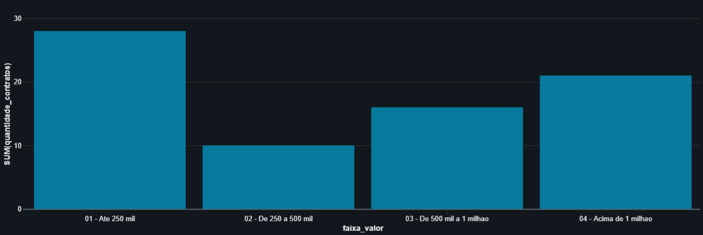

# Análise de Contratos Públicos com SQL

## Sobre o projeto

Este projeto tem como objetivo analisar uma base de contratos públicos utilizando SQL e Databricks, explorando valores contratados, distribuição por órgão, informações de fornecedores e qualidade dos dados.

A proposta é demonstrar habilidades de análise de dados, investigação de inconsistências e elaboração de consultas para apoiar a tomada de decisão.

**Observação:** o projeto utilizará dados fictícios para fins educacionais e de demonstração técnica.

## Objetivos

- Investigar e compreender a estrutura da base de dados.
- Identificar valores ausentes, duplicidades e inconsistências.
- Calcular indicadores relacionados aos contratos.
- Comparar valores contratados entre órgãos.
- Classificar contratos por faixa de valor.
- Aplicar consultas SQL avançadas para responder a perguntas de negócio.

## Tecnologias utilizadas

- SQL
- Databricks
- Common Table Expressions (CTEs)
- CASE WHEN
- JOINs e agregações
- Window Functions

## Perguntas de negócio

1. Qual é o valor total dos contratos analisados?
2. Quais órgãos possuem os maiores valores contratados?
3. Como os contratos se distribuem por faixa de valor?
4. Quais fornecedores aparecem com maior frequência?
5. Existem inconsistências que podem comprometer a análise?
6. Qual órgão apresenta o maior valor total em cada classificação de contrato?

## Metodologia

1. Exploração inicial da base.
2. Verificação da qualidade dos dados.
3. Tratamento de inconsistências, quando necessário.
4. Construção de consultas SQL.
5. Cálculo de indicadores e rankings.
6. Interpretação e documentação dos resultados.

## Estrutura do projeto
 
```text
analise-contratos-publicos/
├── README.md
├── dados/
├── sql/
└── documentacao/
```

## Resultados

Os resultados, indicadores e conclusões serão documentados à medida que as análises forem desenvolvidas e validadas.

## Autor

Wesley Ribeiro dos Santos

Projeto desenvolvido para fins de estudo e demonstração de competências em análise de dados.


## Análise Exploratória — Distribuição dos Contratos



### Principais resultados

A análise de 75 contratos válidos identificou que:

- 28 contratos possuem valores de até R$ 250 mil.
- 21 contratos possuem valores superiores a R$ 1 milhão.
- Esses 21 contratos representam 28% da quantidade total, mas concentram 63,70% do valor financeiro analisado.

**Conclusão:** os contratos de maior valor concentram uma parcela expressiva do valor total, demonstrando a importância da análise de distribuição financeira.
