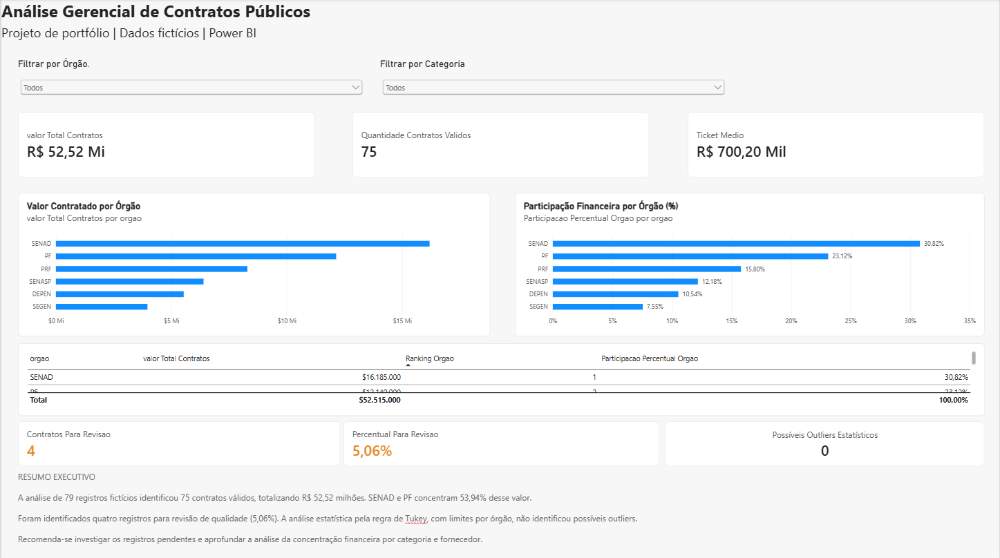
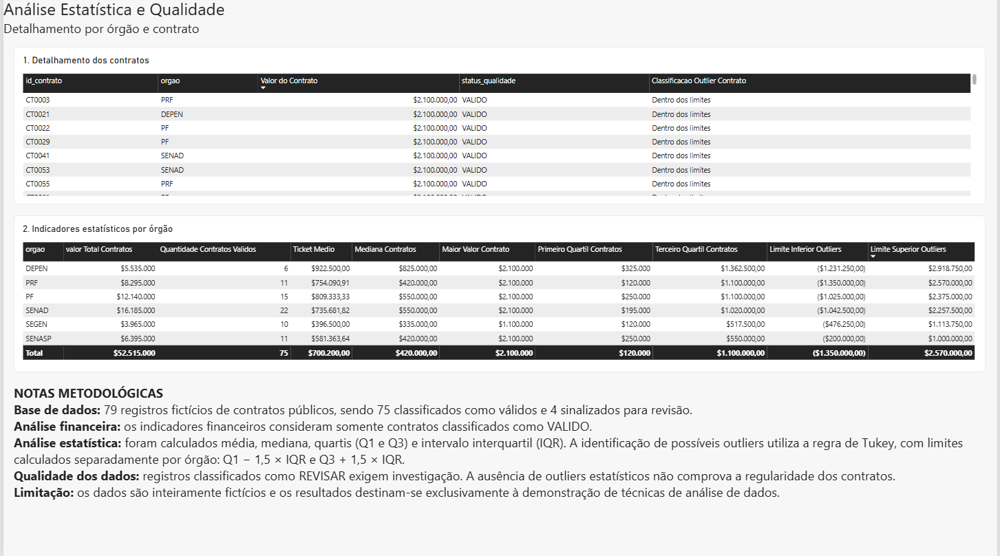

# Análise Gerencial de Contratos Públicos

### Projeto de Portfólio | Engenharia e Análise de Dados

> **Aviso:** este projeto utiliza dados inteiramente fictícios, criados exclusivamente para fins educacionais e de demonstração técnica.

## Objetivo

Desenvolver um fluxo de tratamento, validação, análise estatística e visualização de dados de contratos públicos, transformando registros brutos em indicadores gerenciais para apoio à tomada de decisão.

## Tecnologias utilizadas

- **SQL:** consultas, transformações e análises de dados.
- **Databricks e PySpark:** tratamento e validação dos registros.
- **Power BI:** construção do dashboard interativo.
- **DAX:** criação de indicadores financeiros e estatísticos.
- **GitHub:** documentação e organização do projeto.

## Indicadores do projeto

| Indicador | Resultado |
|---|---:|
| Registros analisados | 79 |
| Contratos válidos | 75 |
| Registros para revisão | 4 |
| Percentual para revisão | 5,06% |
| Valor total dos contratos válidos | R$ 52.515.000 |
| Ticket médio | R$ 700.200 |
| Possíveis outliers identificados | 0 |

## Dashboard — Visão Executiva

Apresenta os principais indicadores financeiros, a distribuição dos valores por órgão, o ranking de participação e os indicadores de qualidade dos dados.

## Dashboard — Análise Estatística e Qualidade

Apresenta o detalhamento dos contratos e indicadores estatísticos por órgão, incluindo média, mediana, quartis e limites para identificação de possíveis valores atípicos.

## Metodologia

1. Análise exploratória dos dados.
2. Tratamento e padronização dos registros.
3. Classificação de qualidade dos contratos.
4. Construção de indicadores financeiros considerando apenas registros válidos.
5. Análise estatística e identificação de possíveis outliers pela regra de Tukey, com limites calculados por órgão.
6. Desenvolvimento e validação do dashboard no Power BI.

## Principais conclusões

- Os órgãos SENAD e PF concentram aproximadamente **53,94%** do valor total dos contratos válidos.
- **5,06%** dos registros foram sinalizados para revisão de qualidade.
- Não foram identificados possíveis outliers estatísticos segundo o critério adotado.
- A ausência de outliers não comprova a regularidade dos contratos.

## Arquivo Power BI

O relatório editável está disponível em:

[Baixar projeto Power BI](powerbi/Analise_Gerencial_Contratos_Publicos.pbix)

---

**Projeto desenvolvido para demonstração de competências em Engenharia de Dados, Análise de Dados, SQL, PySpark, Power BI e DAX.**
